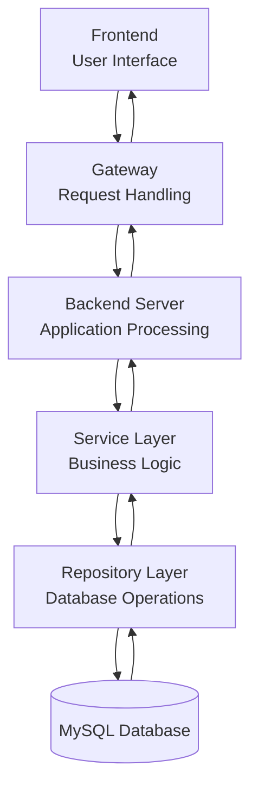

# Networked Student Management System (NSMS)

### A Python & MySQL-Based Client-Server Academic Management Application

**Developed by Sumit Dhaywar**

[](https://www.python.org/)
[](https://www.mysql.com/)
[](https://github.com/sumitdhaywar/Networked-Student-Management-System)
[](https://github.com/sumitdhaywar/Networked-Student-Management-System)

---

## 📌 Project Overview

The **Networked Student Management System (NSMS)** is a network-based academic management application developed using Python and MySQL.

It is designed to centralize academic administration by managing student records, teacher information, courses, allocations, marks, and examination results.

Unlike a basic single-user management application, NSMS follows a multi-layer client-server architecture in which the frontend communicates with a backend through a dedicated gateway.

The project demonstrates practical software development concepts, including database management, network communication, CRUD operations, application architecture, and backend development.

## ✨ Key Features

| Module | Functionality |
|---|---|
| Student Management | Add, search, list, update and delete student records |
| Teacher Management | Maintain teacher information |
| Course Management | Create and manage course records |
| Allocation Management | Connect teachers, students and courses |
| Marks Management | Enter and manage academic marks |
| Result Management | Calculate results and identify toppers |
| Authentication | Student login and account management |
| Database Management | Centralized MySQL data storage |

*Feature descriptions are based on the project development documentation. Individual modules should be verified against the latest source code.*

## 🏗️ System Architecture

NSMS uses a layered client-server architecture.



### Architecture Components

**1. Frontend**
- Accepts user input.
- Displays application information.
- Provides access to management operations.

**2. Gateway**
- Receives frontend requests.
- Routes communication to the backend.
- Handles request processing and validation.

**3. Backend Server**
- Processes application requests.
- Coordinates application functionality.
- Returns responses to the gateway.

**4. Service Layer**
- Handles business logic.
- Coordinates academic operations.

**5. Repository Layer**
- Handles database access.
- Executes SQL operations.

**6. MySQL Database**
- Stores academic records.
- Maintains relationships between entities.

## 🛠️ Technology Stack

| Technology | Purpose |
|---|---|
| Python | Application development |
| MySQL | Relational database |
| SQL | Database queries |
| Git | Version control |
| GitHub | Source code hosting |
| PowerShell | Development environment |

## 🗄️ Database Design

The system is designed around the following main entities:

- Users
- Students
- Teachers
- Courses
- Teacher-Student-Course Allocations
- Marks and Academic Results

### Allocation Relationship

The project documentation identifies a relationship named `teacher_student_allocation`.

Important fields:

- `teacher_id`
- `student_id`
- `course_id`

Composite primary-key and foreign-key constraints are part of the documented database design.

*The complete ER diagram and SQL schema will be added after verification against the actual database.*

## 🔐 Security Considerations

Security-related development considerations include:

- Password hashing.
- Input validation.
- Request sanitization.
- Database relationship constraints.
- Server-side permission checks.
- Keeping database credentials outside public source code.

The actual implementation of each security measure should be verified before considering it complete.

## ⚙️ Installation and Execution

### Prerequisites

- Python 3
- MySQL Server
- Git
- Required Python packages

### 1. Clone the Repository

```bash
git clone https://github.com/sumitdhaywar/Networked-Student-Management-System.git
```

### 2. Open the Project Directory

```bash
cd Networked-Student-Management-System
```

### 3. Configure MySQL

Configure your MySQL database using the project's actual database configuration and schema.

Do not commit passwords or database credentials to GitHub.

### 4. Start the Backend Server

```bash
python server.py
```

### 5. Start the Gateway

Open another terminal in the project directory:

```bash
python frontend/gateway.py
```

### 6. Access the Application

Open your browser:

```text
http://127.0.0.1:8080
```

**Note:** These commands reflect the previously documented development setup. Verify the repository paths, dependencies and database configuration before using them on a fresh installation.

## 🧪 Testing

Previously recorded development testing results:

| Test Category | Historical Result |
|---|---|
| Automated pytest tests | 10 reported passing |
| Live gateway checks | 23/23 reported passing |
| Backend execution | Reported successful |
| Gateway execution | Reported successful |
| Browser access | Reported successful |

These are historical development results, not a claim of a newly verified release. They should be rerun against the current repository before being treated as final test results.

## 📷 Application Screenshots

Screenshots of the actual running application will be added here.

Planned demonstrations:

- Application dashboard
- Student management
- Teacher management
- Course management
- Marks entry
- Result processing

## 🚀 Future Improvements

- Improved application dashboard.
- More comprehensive academic reports.
- Enhanced performance analytics.
- Additional automated testing.
- Improved error handling.
- Database optimization.
- Better user experience.

## 🎯 Learning Outcomes

This project provides practical experience in:

- Python application development.
- MySQL database management.
- Client-server architecture.
- Network communication.
- CRUD operations.
- Relational database design.
- Backend application development.
- Software testing and debugging.
- Git and GitHub workflows.

## 👨‍💻 Developer

**Sumit Dhaywar**

Artificial Intelligence & Machine Learning Diploma Student

- GitHub: [@sumitdhaywar](https://github.com/sumitdhaywar)

---

*Built as a practical software development project with a focus on database management, network communication and modular application architecture.*


